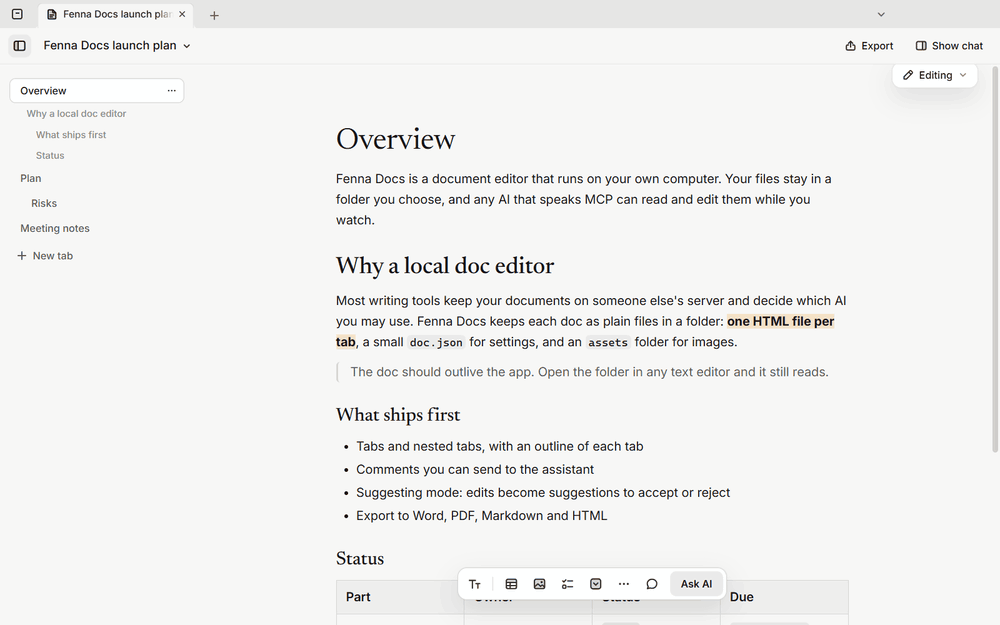
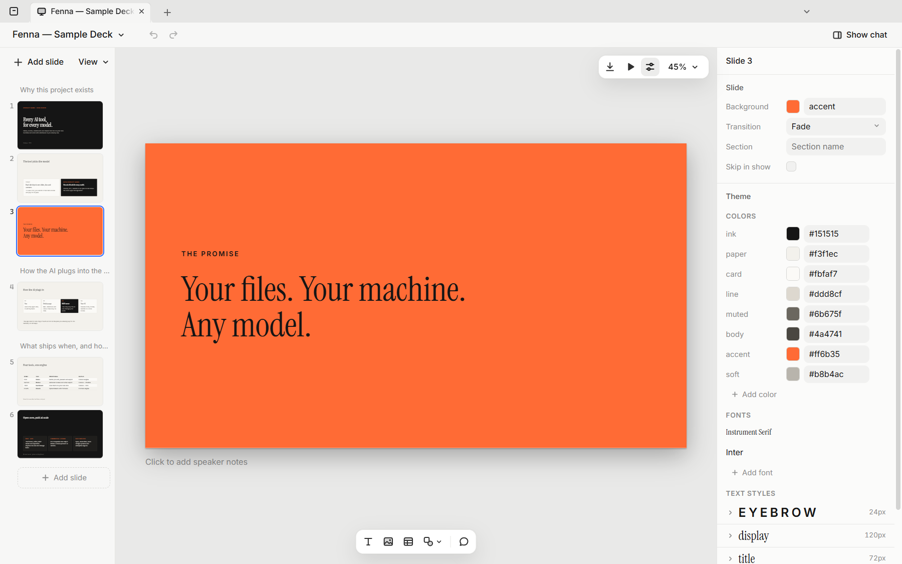
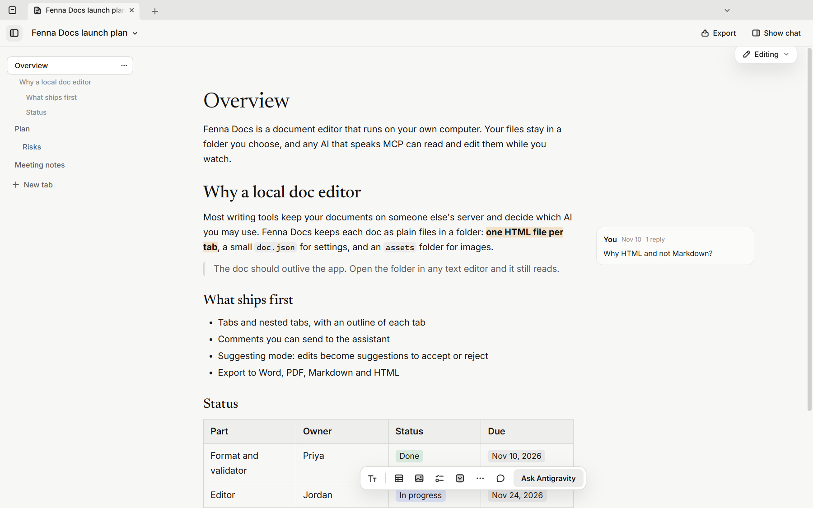
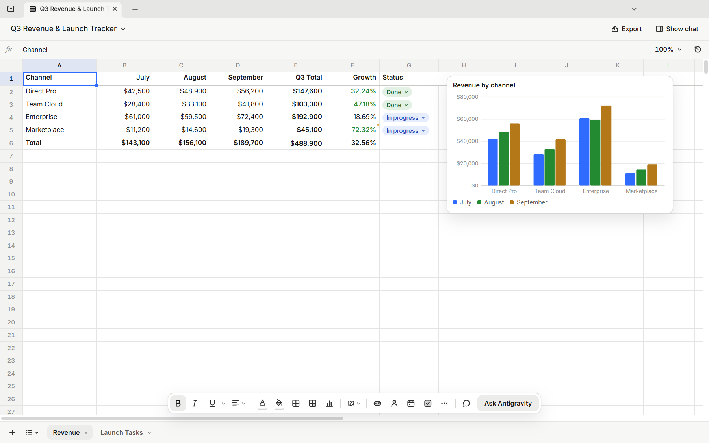
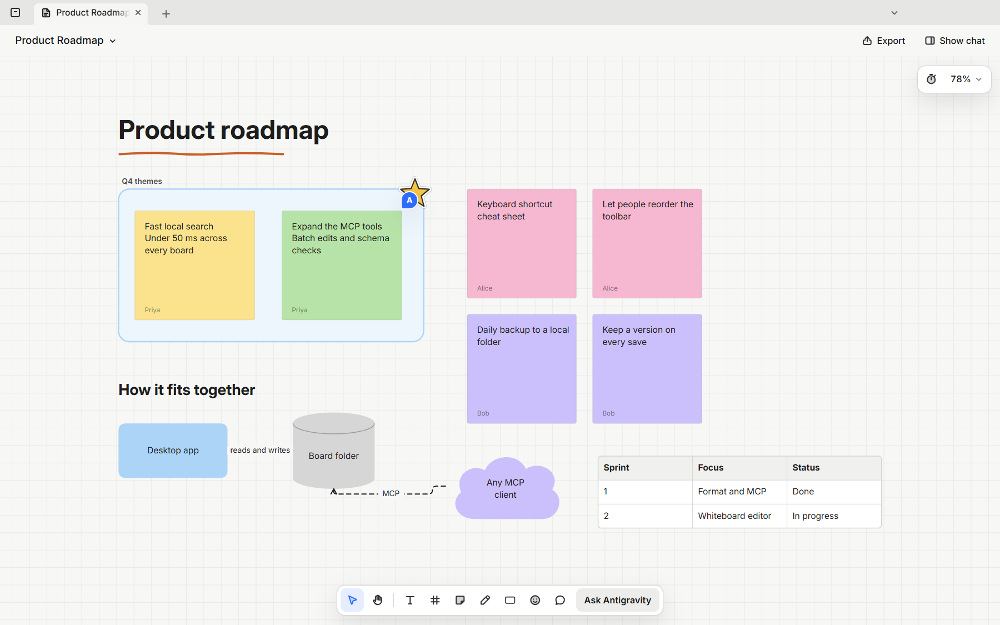

# Fenna

**Slides, docs, sheets and a whiteboard that live on your computer and work with any AI.**

Fenna is four free desktop apps for Windows, macOS and Linux:

| App | For |
|---|---|
| **Fenna Slides** | Decks and presentations, with present mode and PowerPoint, PDF and web export |
| **Fenna Docs** | Memos, plans and notes, with tabs, comments and suggested edits, and Word and Markdown export |
| **Fenna Sheets** | Spreadsheets with formulas, charts and conditional formatting, and Excel and CSV import and export |
| **Fenna Whiteboard** | Brainstorms, flowcharts and retros on an infinite canvas |

Each one is built so an AI can work in it as easily as you can. Claude, GPT,
Gemini or an open model connects through MCP and gets the same tools you
have; you watch every change land and can take over at any moment.

- **No account.** Install it and start. Nothing to sign up for.
- **Your files stay yours.** A deck, doc, sheet or board is a plain folder on
  your computer. No upload, no lock-in; it outlives the app.
- **Use the AI you already pay for.** The chat beside your work runs
  Claude Code, Codex or Antigravity on your own plan, on this computer.



*Edits made through the MCP server land in the open doc as they happen.*

| | |
|---|---|
|  **Slides** |  **Docs** |
|  **Sheets** |  **Whiteboard** |

> Fenna is new (version 0.9). Expect rough edges, and please
> [tell us about them](https://github.com/Sidhilynx/fenna/issues).
> What's coming next is in the [roadmap](ROADMAP.md).

## Download

Get the installers from the [latest release](https://github.com/Sidhilynx/fenna/releases/latest):

| | Windows | macOS (Apple silicon / Intel) | Linux |
|---|---|---|---|
| Slides | `Fenna-Slides-…-setup.exe` | `Fenna-Slides-…-arm64.dmg` / `-x64.dmg` | `.AppImage` or `.deb` |
| Docs | `Fenna-Docs-…-setup.exe` | `Fenna-Docs-…-arm64.dmg` / `-x64.dmg` | `.AppImage` or `.deb` |
| Sheets | `Fenna-Sheets-…-setup.exe` | `Fenna-Sheets-…-arm64.dmg` / `-x64.dmg` | `.AppImage` or `.deb` |
| Whiteboard | `Fenna-Whiteboard-…-setup.exe` | `Fenna-Whiteboard-…-arm64.dmg` / `-x64.dmg` | `.AppImage` or `.deb` |

The apps aren't code-signed yet, so your system will ask before the first start:

- **Windows:** "Windows protected your PC" → **More info** → **Run anyway**.
- **macOS:** open the app once, then **System Settings → Privacy & Security →
  Open Anyway**.
- **Linux AppImage:** make it executable (`chmod +x Fenna-*.AppImage`), then run it.

When a new version is out, Home shows it with a download link. Nothing
installs by itself.

## Use it with any AI

Each app comes with an MCP server. The chat inside the app uses it already;
any other MCP client can use it on a file directly. From a clone of this
repository (Node 22.18 or later, which runs TypeScript directly):

```sh
npm install
node packages/mcp/src/cli.ts       --deck  examples/sample-deck     # fenna-slides
node packages/doc-mcp/src/cli.ts   --doc   examples/sample-doc      # fenna-docs
node packages/sheet-mcp/src/cli.ts --sheet examples/sample-sheet    # fenna-sheets
node packages/board-mcp/src/cli.ts --board examples/sample-board    # fenna-whiteboard
```

For example, in Claude Code:

```sh
claude mcp add fenna-docs -- node /path/to/fenna/packages/doc-mcp/src/cli.ts --doc /path/to/my-doc
```

| Server | Tools |
|---|---|
| `fenna-slides` | `deck_overview`, `format_guide`, `read_slides`, `edit_slide`, `write_slide`, `write_slides`, `check_slide`, `delete_slides`, `arrange_slides`, `update_deck`, `read_comments`, `comment` |
| `fenna-docs` | `doc_overview`, `format_guide`, `read_tab`, `edit_blocks`, `write_tab`, `check_tab`, `delete_tab`, `update_doc`, `read_comments`, `comment` |
| `fenna-sheets` | `workbook_overview`, `format_guide`, `read_range`, `find`, `write_cells`, `format_cells`, `clear_cells`, `edit_structure`, `manage_rules`, `manage_charts`, `add_sheet`, `delete_sheet`, `update_workbook`, `read_comments`, `comment` |
| `fenna-whiteboard` | `read_board`, `add_items`, `edit_items`, `delete_items`, `arrange`, `rename_board`, `format_guide`, `read_comments`, `comment` |

Every edit is checked against the file format and saved whole or not at all.
Files carry versions, so an AI never overwrites a change you made after it
last read.

## How a file works

| App | Folder |
|---|---|
| Slides | `deck.json` (title, slide order, sections, theme) and one small HTML file per slide in `slides/` |
| Docs | `doc.json` (title, tabs, fonts) and one HTML file per tab |
| Sheets | `sheet.json` (title, locale, sheet list) and one JSON file per sheet |
| Whiteboard | `board.json` and `canvas.json` (every item and connector) |

Images and fonts sit in `assets/`. The formats are strict, documented
subsets that people and models can both read and write by hand.

## Build from source

```sh
npm install
npm test
npm run typecheck
npm run dev -w @opendeck/desktop       # Slides, with hot reload (also docs, sheets, whiteboard)
npm run dist -w @opendeck/desktop      # installers in apps/desktop/release/
```

On Windows, use PowerShell and a path with a capital drive letter
(`D:\...`). The code's internal package names (`@opendeck/*`) are from
before the Fenna name.

## Repository

```
packages/shell        what every app shares: tabs, Home, the AI chat, UI kit
packages/format       slides: format          packages/mcp        slides: MCP server
packages/render       slides: one renderer for editor, thumbnails, present and export
packages/doc          docs: format            packages/doc-mcp    docs: MCP server
packages/sheet        sheets: format          packages/sheet-mcp  sheets: MCP server
packages/board        whiteboard: format      packages/board-mcp  whiteboard: MCP server
apps/desktop          Fenna Slides            apps/docs           Fenna Docs
apps/sheets           Fenna Sheets            apps/whiteboard     Fenna Whiteboard
examples/             a sample of each kind of file
```

## Contributing

Bug reports and pull requests are welcome. Read [CONTRIBUTING.md](CONTRIBUTING.md)
first: it has the code rules, and every contributor signs the
[Contributor License Agreement](CLA.md) once.

- Where it's going: [ROADMAP.md](ROADMAP.md)
- Security problems: [SECURITY.md](SECURITY.md)
- What the apps send over the network: [PRIVACY.md](PRIVACY.md)
- Using the Fenna name: [TRADEMARKS.md](TRADEMARKS.md)

## License

[AGPL-3.0](LICENSE). A commercial license is available for companies that
want to ship Fenna inside a closed product or service; open an issue to ask.

Fenna is made by [Sidhilynx](https://github.com/Sidhilynx).
