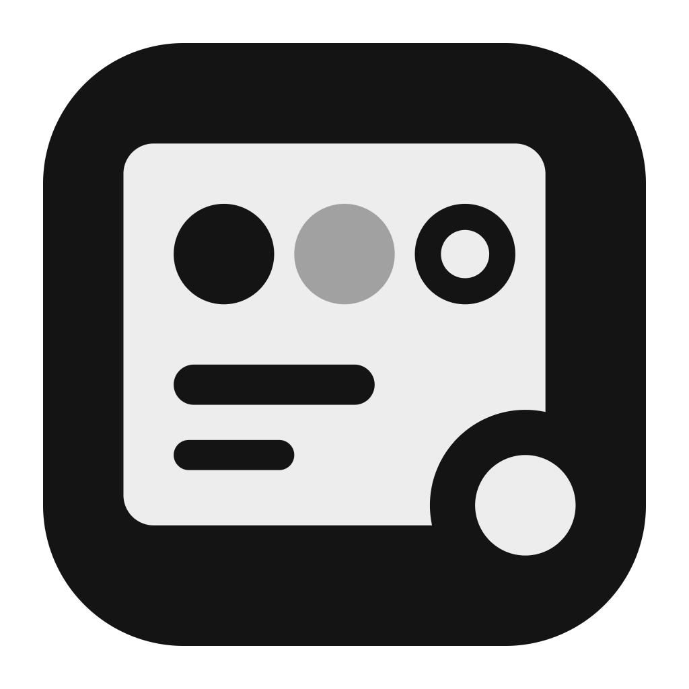
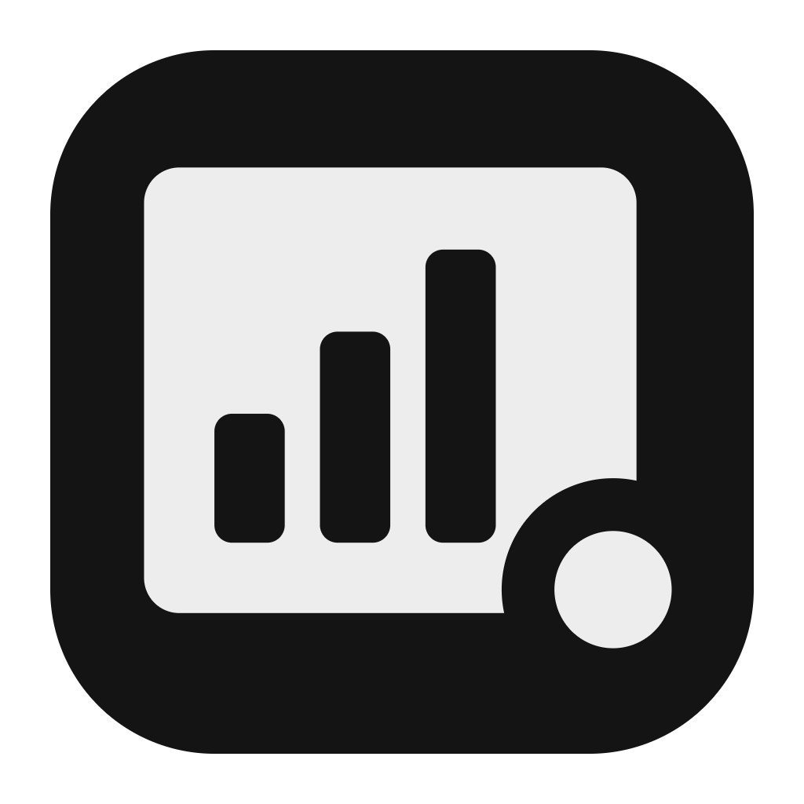
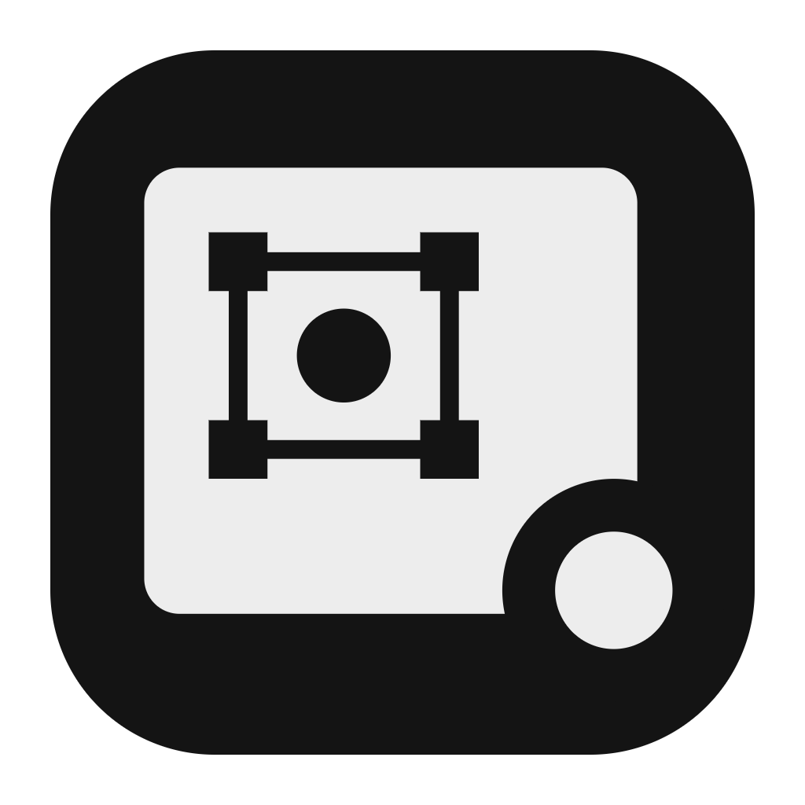
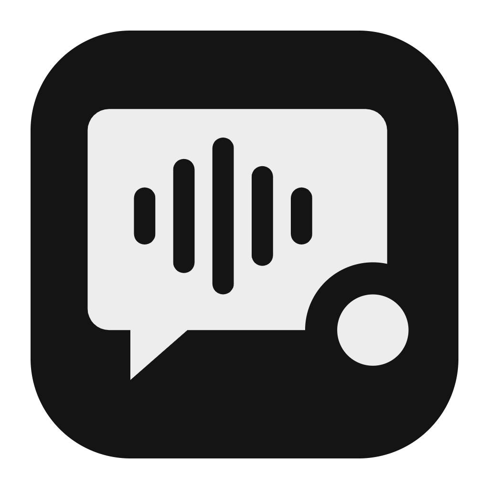
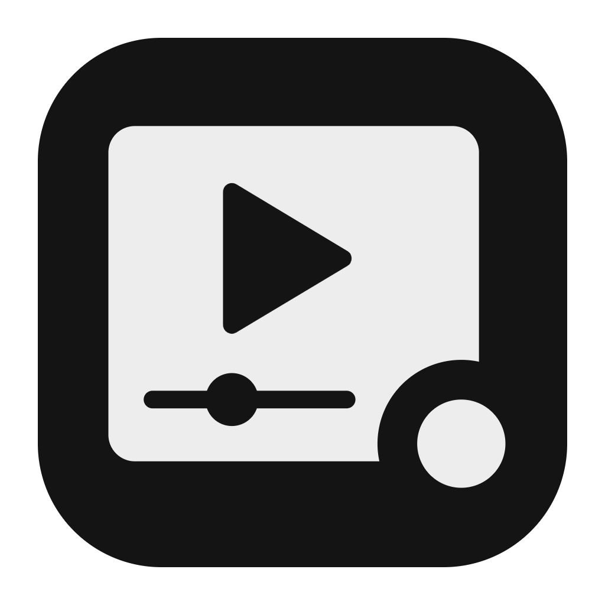

# Roadmap

Where Fenna is going. Plans change with what people ask for: vote on the
[issues](https://github.com/Sidhilynx/fenna/issues) you care about with a
thumbs-up, or open one. Work in progress is grouped by
[milestone](https://github.com/Sidhilynx/fenna/milestones).

Fenna is a family of apps that share one shell, one way of storing files
(plain folders) and one way for any AI to work in them (MCP). New apps are
built side by side, not one after another.

## Now: 0.9, the first public release

Fenna Slides, Docs, Sheets and Whiteboard for Windows, macOS and Linux, each
with an MCP server and a chat for the AI you already use. No account.

- Fix what the first users find. Bugs come before anything new.
- Make each MCP server work first time with more models and clients.
- Open PowerPoint, Word and Excel files, not only export to them, so moving
  to Fenna doesn't mean starting over.

## Next: new apps, built in parallel

| | App | For |
|---|---|---|
|  | **Fenna Brand** | One brand file (colors, fonts, logo, text styles, components) that every other app reads, so a deck, a doc and a design look like they come from the same company. |
|  | **Fenna Data** | Dashboards, metrics pages and reports from CSV files, sheets and databases. Every number shows where it came from. |
|  | **Fenna Design** | A canvas of artboards for screens, landing pages, posters, social posts and ads, exported to PNG, SVG and PDF. |
|  | **Fenna Meeting** | Record or import a meeting, transcribe it on your own computer, and turn it into notes, decisions and action items in Docs and Sheets. |
|  | **Fenna Motion** | Animated scenes and short videos on a timeline: title cards, product reveals, explainers, exported to MP4 and GIF. |

Each one follows the same rules as the first four: a file is a folder you
own, any AI can work in it through MCP, and nothing needs an account.

## Then: one family

- **Fenna in one window.** One app with every Fenna app in its tabs, for
  people who use more than one. The separate apps stay.
- **Work moves between apps.** A sheet's chart in a deck or a doc, a board
  turned into slides, meeting notes into a doc and their actions into a
  sheet, the brand applied everywhere.
- **Templates** for every app.
- **Signed installers**, so Windows and macOS stop asking before the first
  start.

## Later

- **Fenna Cloud**, optional. Sync between your computers, share a link,
  work on a file together. The apps keep working without it, and your files
  stay plain folders you own.

## Not planned

- Requiring an account to use the apps.
- Sending your files anywhere you didn't choose.
